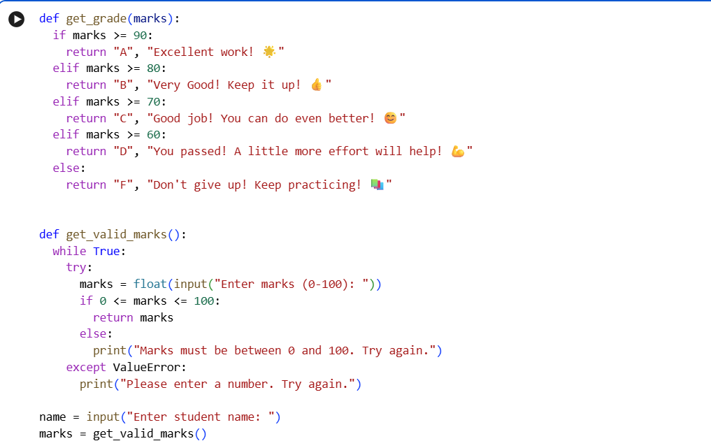
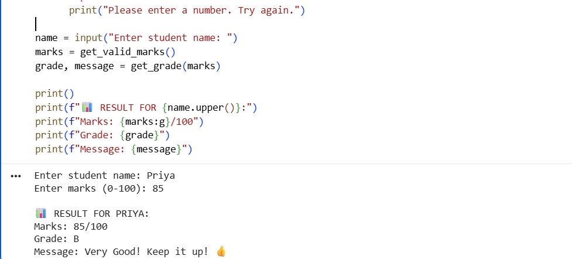
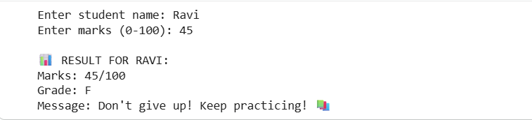
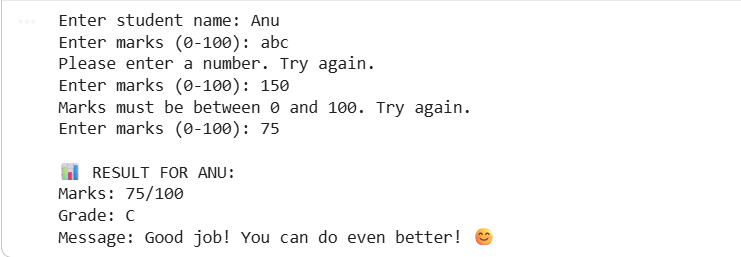

# Student Grade Calculator

## Project Overview
A Python program that takes a student's name and marks (0-100) and shows the grade (A, B, C, D or F) with an encouraging message. The goal is to practice if-elif-else statements, while loops, functions and input validation.

## Setup Instructions
1. Install Python 3 from python.org (or use Google Colab, which needs no installation).
2. Download grade_calculator.py from this repository.
3. Run it with: python grade_calculator.py
4. Enter the student name and marks when asked.

## Code Structure
- grade_calculator.py : the main program
- test_cases.txt : the test cases and results
- screenshots/ : screenshots of the code and test runs

## Visual Documentation
Code (part 1):

Code (part 2) and Test 1 output:

## Technical Details
Grading logic:
- A: 90-100
- B: 80-89
- C: 70-79
- D: 60-69
- F: 0-59

Functions used:
- get_grade(marks) : uses if-elif-else statements to return the grade and an encouraging message.
- get_valid_marks() : uses a while loop with try-except to keep asking until the marks are a number between 0 and 100.

The main program takes the name, gets valid marks, finds the grade and prints the result with f-strings.

## Testing Evidence
Test 1 (normal marks): Priya, 85 gives Grade B.

Test 2 (low marks): Ravi, 45 gives Grade F.

Test 3 (invalid input): Anu, abc and 150 are rejected with an error message, then 75 gives Grade C.

More test cases are in test_cases.txt.

## What I Learned
I learned how to use if-elif-else statements, while loops, functions and input validation in Python, and how to organize a project on GitHub.
